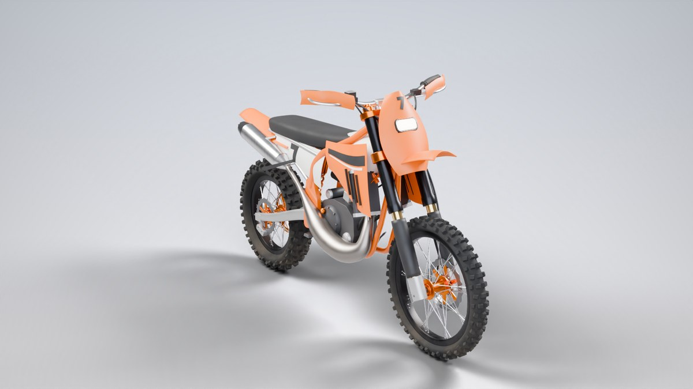
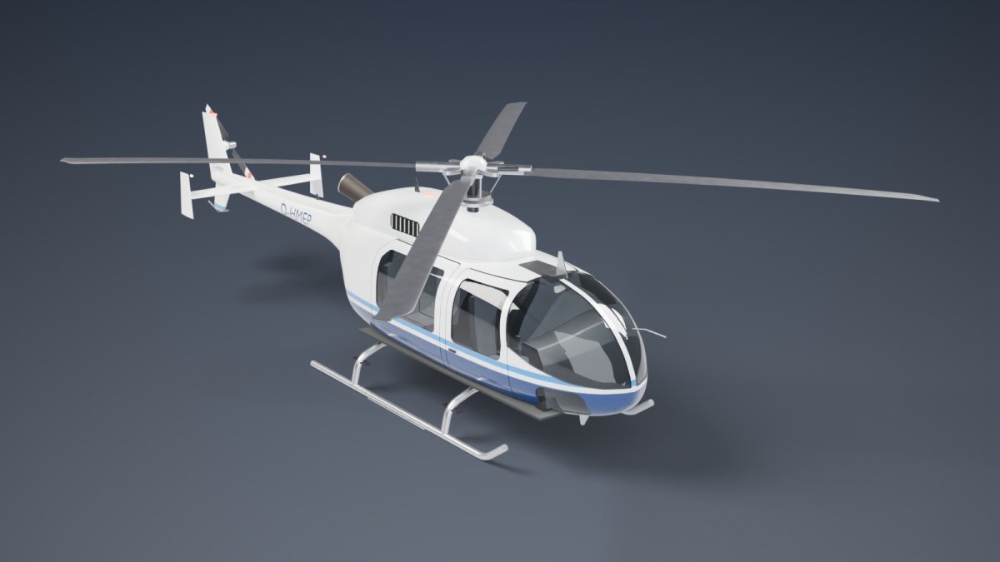
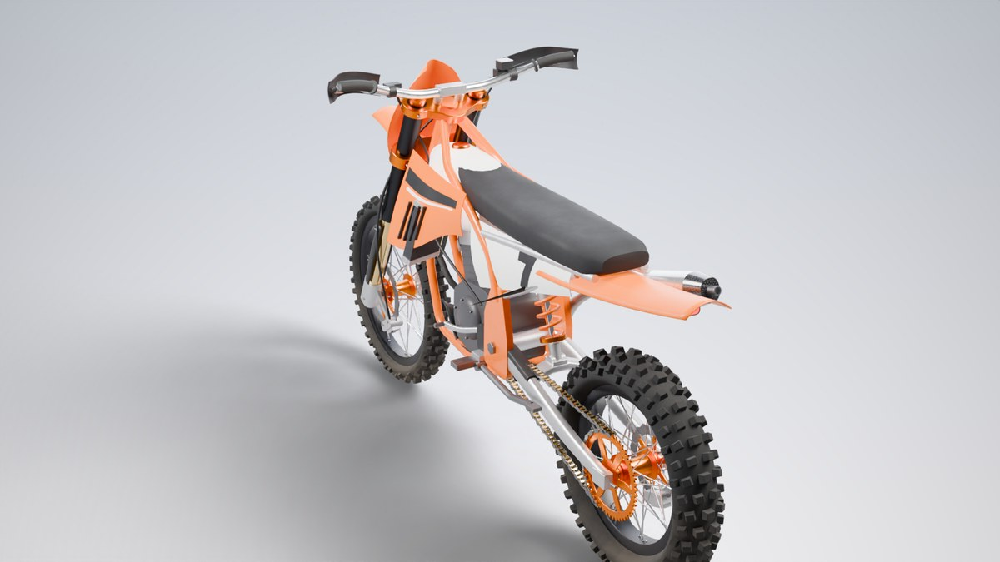
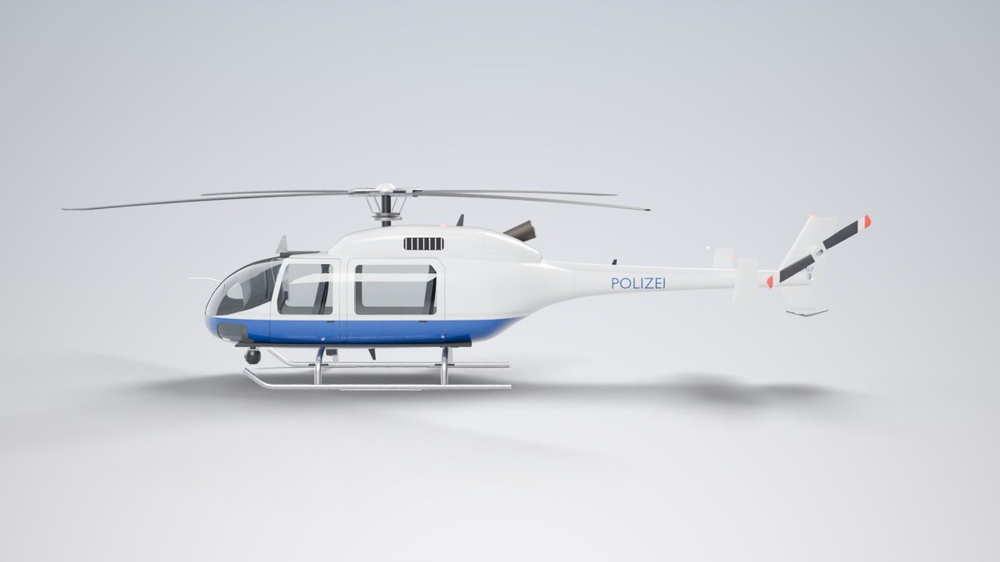
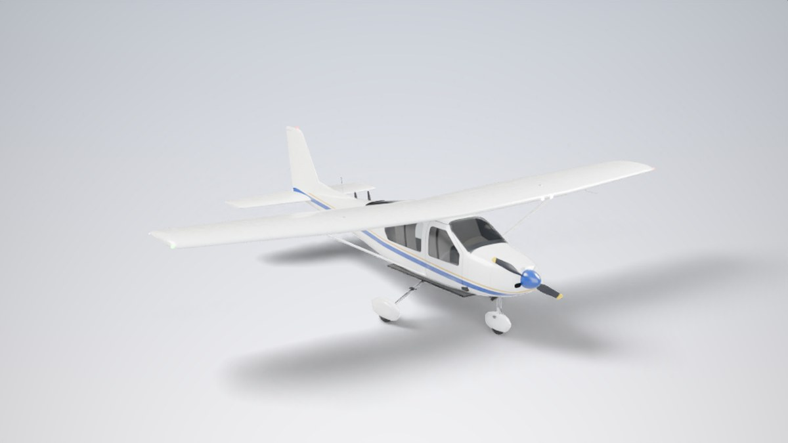
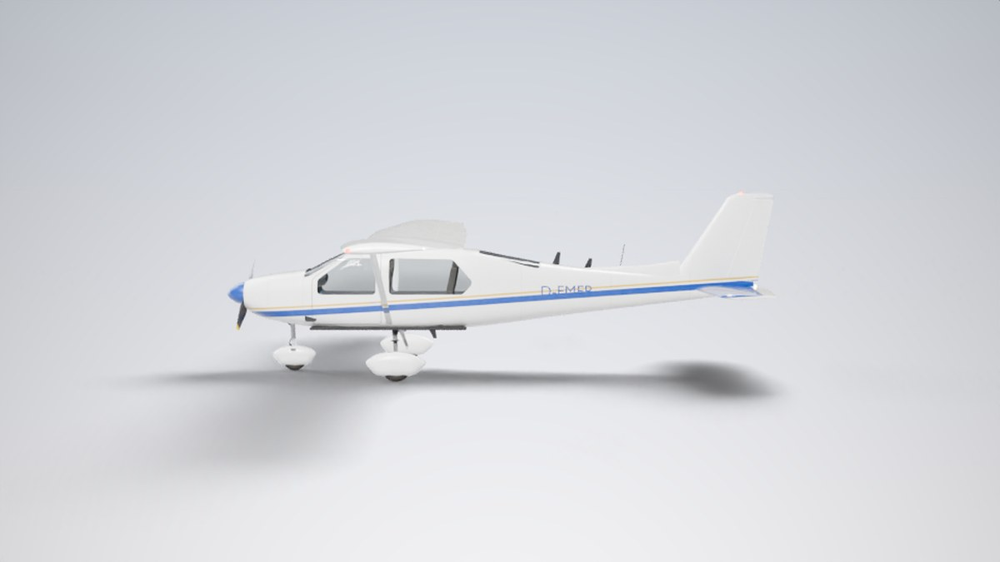

# 3D-Heli – prozedurale Game-Ready-Fahrzeuge (Enduro, Hubschrauber & Flugzeug)

`vehicle_generator.py` ist ein Python-Script für **Blender (bpy)**, das drei detaillierte,
realistisch proportionierte 3D-Modelle vollständig prozedural erzeugt und als
**engine-fertige Assets** exportiert:

| Enduro (300er Zweitakt) | Hubschrauber (leichter Turbinenheli) |
|---|---|
|  |  |
|  |  |

| Flugzeug (einmotoriger Hochdecker) | |
|---|---|
|  |  |

Die Vorschaubilder sind mit `--preview` direkt aus dem Script gerendert (Cycles).

---

## Was erzeugt wird

**Enduro** – reale Maße einer Hardenduro (Radstand 1,48 m, Sitzhöhe ~0,96 m, 21"/18"-Räder):
Gitterrohr-Rahmen mit Heckrahmen, USD-Gabel mit Gabelbrücken und Gabelschützern, Lenker mit
Griffen, Armaturen und Handprotektoren, Speichenräder (36 Speichen, Nippel, Naben,
Wave-Bremsscheiben, Bremssättel) mit **einzeln modellierten Reifenstollen**, Zweitaktmotor mit
Zylinder, Deckeln, Anlasser, **Auspuffbirne mit echtem Querschnittsverlauf** und Endschalldämpfer
(Carbon-Endkappe), Kühler + Schläuche, PDS-Federbein mit Schraubenfeder, Schwinge, **Kette mit
~115 Gliedern** auf berechnetem Verlauf, Kettenräder, Fußrasten, Hebel, Seitenständer,
Brems-/Kupplungs-/Gasleitungen, Tank, Sitzbank, Kühlerspoiler, Seitenteile, Kotflügel,
Lampenmaske mit Scheinwerfer, Rücklicht, Grafik-Kit und Startnummern (Mesh-Decals).

**Hubschrauber** – Klasse ~10,7 m Rotordurchmesser: Rumpf als Spanten-Loft mit
**echten Fenster- und Türausschnitten** (Boolean + Normalen-Transfer für sauberes Shading),
vier separat bewegliche Türen mit Scheiben, Innenraum (Sitze, Instrumentenbrett mit Displays,
Steuerknüppel, Pitch, Pedale), Triebwerksverkleidung mit Lufteinlässen und Abgasrohr,
Hauptrotor mit **NACA-Profilblättern** (Verwindung, Zuspitzung, Durchbiegung im Stand),
Rotorkopf mit Taumelscheibe und Steuerstangen, Heckrotor mit Getriebe, Seiten- und
Höhenleitwerk mit Endscheiben, Kufengestell mit Trittstufen, Positions-, Anti-Kollisions- und Landelicht,
Antennen, Drahtschneider, Pitotrohr, Panel-Fugen, Kennzeichen/Schriftzug als Mesh-Decals.
Lackierungen: `civil`, `police` (inkl. drehbarer Wärmebildkamera + Suchscheinwerfer),
`rescue`, `military`.

**Flugzeug** – viersitziger Hochdecker der Cessna-172-Klasse (8,3 m lang, 11 m Spannweite):
Rumpf-Loft mit Motorhaube, Lufteinlässen und Auspuff, **Fenster und Türen als echte Ausschnitte**
(Windschutzscheibe, Türscheiben, hintere Seitenfenster, Heckscheibe), zwei bewegliche Türen,
Innenraum (vier Sitze, Instrumentenbrett mit Displays, zwei Steuerhörner), gewölbter Flügel
(NACA 2412, rechteckig innen / trapezförmig außen, V-Stellung, Schränkung) mit **separaten Klappen
und Querrudern an Scharnier-Pivots**, Flügelstreben, Randbögen mit Positionslichtern,
Landescheinwerfer, Tankdeckel, Pitotrohr, Höhenleitwerk mit Höhenruder, Seitenleitwerk mit
Seitenruder und Rückenflosse, **Zweiblatt-Propeller mit realer Steigungsverteilung**, Spinner,
Bugradfahrwerk (lenkbar) und Federstahl-Hauptfahrwerk mit Radverkleidungen, Antennen,
Panel-Fugen und Kennzeichen (Mesh-Decal). Lackierungen: `classic`, `trainer`, `bush`, `military`.

## Game-Ready-Pipeline

| Schritt | Ergebnis |
|---|---|
| Maßstab | Meter, Ursprung am Boden; Ausrichtung je Ziel-Engine (`--target`) |
| Hierarchie | Jedes bewegliche Teil hängt an einem Pivot (Lenkung, Gabel, Räder, Schwinge, Rotoren, Blätter, Türen, Klappen, Quer-/Höhen-/Seitenruder, Propeller, Bugrad …) mit Drehpunkt bzw. Scharnierachse an der physikalisch richtigen Stelle |
| Skelett (`--rig`) | Zusätzliches Skeletal Mesh `SK_*` mit Knochen pro Pivot, starr gewichtet – direkt für Chaos Vehicles / Unity-Animator nutzbar |
| Meshes | Modifier angewendet, trianguliert, pro Pivot zusammengeführt (wenige Draw Calls), Glas separat |
| UV | Ein gemeinsamer, überlappungsfreier UV-Atlas pro Fahrzeug |
| Texturen | Bake aller prozeduralen Materialien in **BaseColor, Normal (OpenGL + DirectX für Unreal), ORM (AO/Roughness/Metallic), Emissive**; für Unity zusätzlich `MetallicSmoothness` und HDRP-`MaskMap` |
| Material | Ein Engine-Material pro Fahrzeug (+ Glas) |
| LODs | LOD0–LOD3 (50 % / 25 % / 12 %), Kleinteile (Speichen, Kette, Leitungen, Decals …) werden stufenweise entfernt |
| Kollision | Konvexe `UCX_*`-Hüllen (Unreal-Konvention), max. 48 Vertices |
| Sockets | `SOCKET_*`-Empties: Fahrer-/Pilotensitz, Fußrasten, Griffe, Auspuff, Scheinwerfer, Winde, Rotornabe … |
| Export | FBX, GLB (glTF 2.0) und `.blend` + JSON-Report mit Polycounts, Pivots, Sockets, Dateien |

Gemessene Polycounts (Standardeinstellungen, Dreiecke; Heli mit `police`-Lackierung):

| Asset | LOD0 | LOD1 | LOD2 | LOD3 |
|---|---|---|---|---|
| Enduro | 137 958 | 67 839 | 31 172 | 14 848 |
| Hubschrauber | 72 222 | 36 107 | 17 658 | 7 477 |
| Flugzeug | 64 930 | 32 463 | 16 099 | 6 151 |

---

## Installation

**Variante A – Blender** (empfohlen): [Blender](https://www.blender.org/download/) installieren.
Getestet mit Blender/bpy **5.2.2**; ausgelegt für Blender 4.2 und neuer (4.x selbst ist ungetestet).

**Variante B – reines Python**: `pip install -r requirements.txt` (bpy 5.2 benötigt Python 3.13).

## Benutzung

```bash
# Alle drei Fahrzeuge für Unreal exportieren (Standard: FBX + GLB + .blend, 2K-Bake, 3 LODs)
blender --background --python vehicle_generator.py -- --out export

# Nur den Heli, Polizei-Lackierung, mit Skelett, 4K-Texturen, für Unity
blender -b -P vehicle_generator.py -- --vehicle heli --heli-livery police --rig --bake 4096 --target unity

# Enduro in Blau, schneller Test ohne Bake, mit Vorschaubildern
python vehicle_generator.py --vehicle enduro --enduro-color blue --bake 0 --preview

# Flugzeug als Schulflugzeug-Lackierung mit Skelett (Ruder, Klappen, Propeller, Räder als Knochen)
blender -b -P vehicle_generator.py -- --vehicle plane --plane-livery trainer --rig
```

**In der Blender-Oberfläche:** Tab *Scripting* → `vehicle_generator.py` öffnen → *Run Script*.
Alle Modelle werden (ohne Export) nebeneinander in die aktuelle Szene gebaut – ideal zum
Anschauen und Weiterbearbeiten.

### Optionen

| Option | Standard | Beschreibung |
|---|---|---|
| `--vehicle {enduro,heli,plane,all}` | `all` | Welche Modelle gebaut werden |
| `--out DIR` | `export` | Ausgabeordner |
| `--target {unreal,unity,godot,generic}` | `unreal` | Ausrichtung (Unreal: +X vorne; sonst Blender −Y vorne = Unity +Z / glTF +Z), FBX-Skalierung, Textur-Packing |
| `--formats` | `fbx,glb,blend` | Exportformate |
| `--bake N` | `2048` | Texturauflösung des PBR-Bakes, `0` = kein Bake (Materialien bleiben prozedural) |
| `--bake-samples N` | `32` | Samples für den AO-Bake |
| `--lods N` | `3` | Zusätzliche LOD-Stufen (0–4) |
| `--rig` | aus | Zusätzlich Skeletal Mesh `SK_*.fbx/.glb` |
| `--no-collision` | – | Keine UCX-Kollisionshüllen |
| `--preview` | aus | Studio-Renderings nach `OUT/previews/` |
| `--gpu` | aus | Cycles auf der GPU (Bake & Preview) |
| `--enduro-color` | `orange` | `orange`, `blue`, `red`, `green`, `yellow` |
| `--heli-livery` | `civil` | `civil`, `police`, `rescue`, `military` |
| `--plane-livery` | `classic` | `classic`, `trainer`, `bush`, `military` |
| `--blades N` | `4` | Anzahl Hauptrotorblätter (2–7) |
| `--dirt F` | `0.35` | Verschmutzungsgrad 0–1 (Schlamm/Staub, im Bake enthalten) |
| `--seed N` | `7` | Variation (Stollenmuster, Startnummer, Kennzeichen) |
| `--enduro-name`, `--heli-name`, `--plane-name` | `SM_Enduro`, `SM_Heli`, `SM_Plane` | Asset-Namen |

Laufzeit (CPU, 4 Kerne, Standardeinstellungen inkl. `--rig`): ca. 1,5 min (Enduro), 3 min (Heli) und
4 min (Flugzeug), der größte Teil ist der Textur-Bake. Mit `--bake 0` dauert ein Fahrzeug nur wenige Sekunden.

### Ausgabe

```
export/
├── SM_Enduro.fbx / .glb          LOD0 mit Pivot-Hierarchie, Sockets, UCX-Kollision (FBX)
├── SM_Enduro_LOD1..3.fbx / .glb
├── SK_Enduro.fbx / .glb          (--rig) Skeletal Mesh + Skelett
├── SM_Enduro.blend               bearbeitbare Szene
├── SM_Enduro_report.json         Polycounts, Pivots (Position/Achse), Sockets, Dateien
├── Textures/
│   ├── T_Enduro_BaseColor.png    sRGB
│   ├── T_Enduro_Normal.png       OpenGL (Y+)  – Blender, Unity, Godot
│   ├── T_Enduro_Normal_DX.png    DirectX (Y−) – Unreal (nur --target unreal)
│   ├── T_Enduro_ORM.png          R = AO, G = Roughness, B = Metallic
│   └── T_Enduro_Emissive.png     Scheinwerfer, Rücklicht, Displays …
└── summary.json
```

## Import in die Engine

**Unreal Engine**
- *Statisch / Hierarchie:* `SM_*.fbx` importieren. Für ein einzelnes Static Mesh „Combine Meshes“
  aktivieren; die Kollisionshüllen folgen der Konvention `UCX_<Asset>_##` (z. B. `UCX_SM_Enduro_00`).
  Ohne Combine bleiben die Teile einzeln (z. B. für Blueprint-Animation an den Pivots).
- *Fahrzeug (Chaos Vehicles):* `SK_*.fbx` als Skeletal Mesh importieren. Knochen: `root`,
  `Steering`, `ForkLower`, `WheelFront`, `Swingarm`, `WheelRear` bzw. `MainRotor`, `Blade_1..n`,
  `TailRotor`, `Door_*`, `FLIR` bzw. `Propeller`, `Aileron_L/R`, `Flap_L/R`, `Elevator`, `Rudder`,
  `NoseGear`, `WheelNose`, `WheelMain_L/R`, `Door_L/R`. Physics Asset in Unreal erzeugen.
  Ruder und Klappen drehen um die Y-Achse ihres Knochens (= Scharnierlinie).
- Material: `T_*_Normal_DX.png` als Normal Map, `T_*_ORM.png` mit *sRGB aus*.
- LODs: `SM_*_LOD1..3.fbx` im Static-Mesh-Editor als LOD importieren.

**Unity** (`--target unity`)
- FBX importieren; die Front zeigt nach +Z (bei Bedarf *Bake Axis Conversion* aktivieren).
- URP/Built-in: `T_*_MetallicSmoothness.png` + `T_*_Normal.png`; HDRP: `T_*_MaskMap.png`.
- LODs per *LOD Group* mit den `_LOD1..3`-Dateien zusammenstellen.

**Godot / Web / andere** (`--target godot`)
- `*.glb` direkt verwenden – Materialien, Texturen (inkl. AO) und Hierarchie sind enthalten.
- Glas wird als `KHR_materials_transmission` exportiert.

## Anpassen & Erweitern

- **Proportionen Enduro:** Klasse `EnduroGeo` (Radstand, Lenkkopfwinkel, Gabelversatz, Schwingenlager …).
  Alle Teile referenzieren diese Werte.
- **Rumpfform Heli:** `HeliGeo.STATIONS` – Spantentabelle (Halbbreite, Ober-/Unterkante,
  Superellipsen-Exponenten). Fenster/Türen sind 2D-Konturen in der Seitenansicht in `build_heli`.
- **Flugzeug:** `PlaneGeo` – Rumpfspanten, Flügelgrundriss (Profiltiefe innen/außen, Pfeilung,
  V-Stellung, Schränkung, Wölbung), Propeller und Fahrwerksmaße; Klappen-/Querruder-Spannweiten
  und Ruder-Scharnierlinien in `build_plane`.
- **Farben/Lackierungen:** `ENDURO_PALETTES`, `HELI_LIVERIES`, `PLANE_LIVERIES` (Farbbänder über
  Welt-Höhe, beim Flugzeug schräg ansteigend, Schriftzug, Textfarbe).
- **Neue Teile:** Baukasten-Funktionen `loft_stations`, `lathe`, `tube`, `extrude`, `surface_grid`,
  `airfoil_loft`, `text_md` + `project_onto` (Decals) und `Assembly.add(mesh, name, pivot)`.

## Grenzen

Die Modelle sind vollständig aus Code entstanden – mit echten Maßen, sauberer Topologie,
PBR-Materialien und kompletter Engine-Pipeline. Ein von Hand gebautes AAA-Hero-Asset enthält
zusätzlich typischerweise: High-Poly-Sculpt → Normal-Bake, Trim-Sheets und mehrere
Texture-Sets mit höherer Texeldichte, Schadens-/Verschleißstufen, ein voll ausmodelliertes Cockpit
sowie Fahrzeug-Setup (Federung, Rotor-/Propeller-Blur-Meshes, Flugphysik) in der Engine. Dafür ist dieses Script die
Grundlage: alle Maße, Pivots, LODs und Exporte stehen, und jedes Teil lässt sich in Blender oder
im Code weiter verfeinern.
