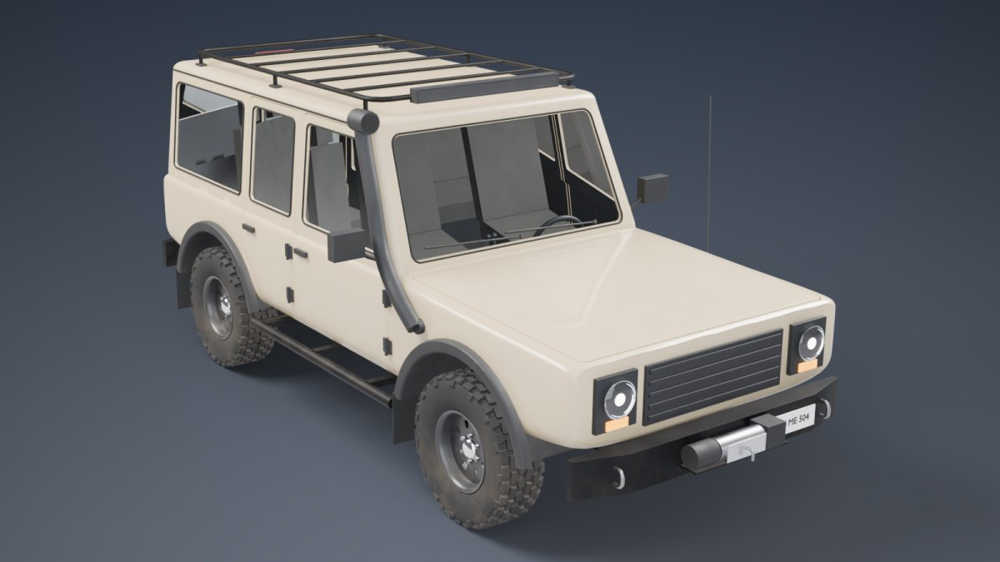
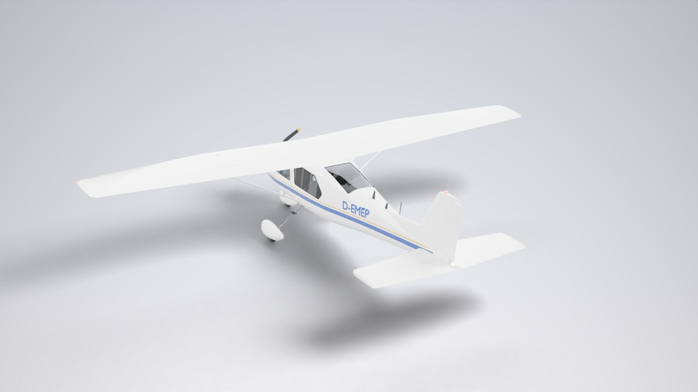
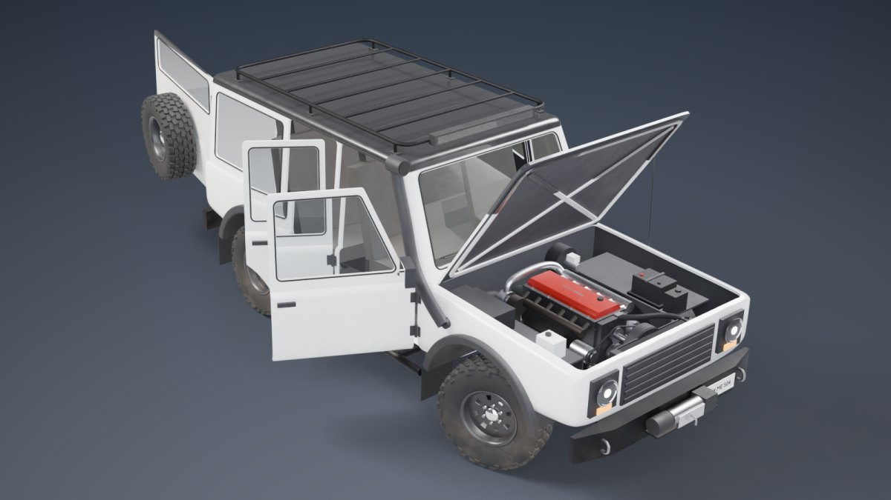
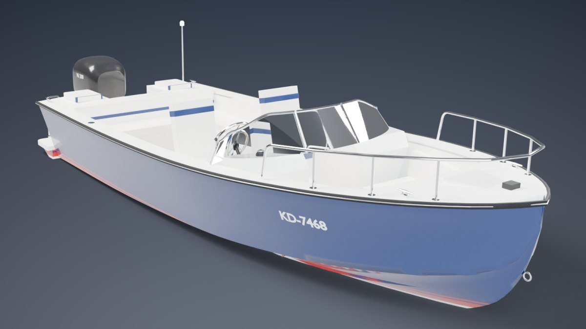
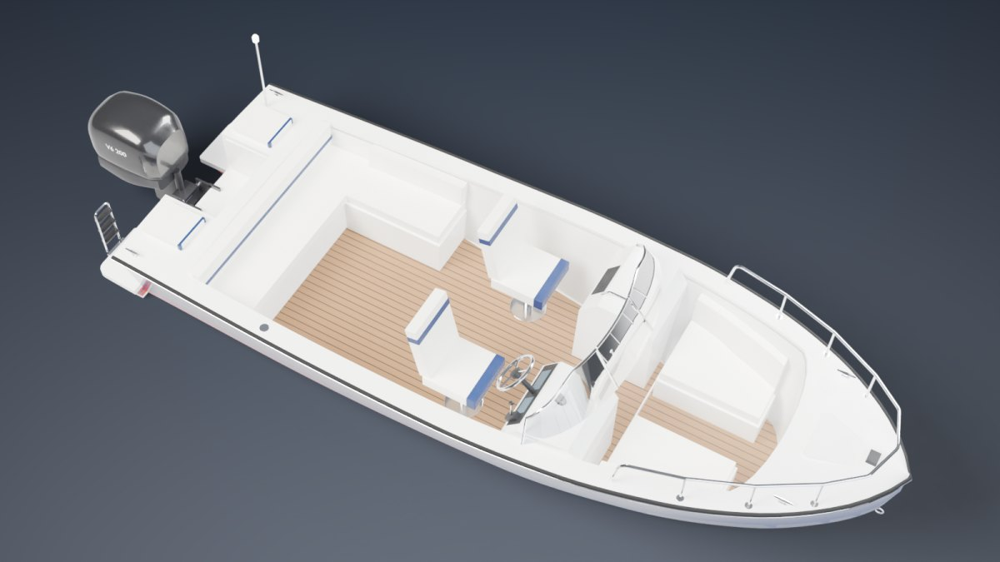

# 3D Vehicle Factory – prozedurale Game-Ready-Fahrzeuge (Enduro, Hubschrauber, Flugzeug, Geländewagen & Motorboot)

`vehicle_generator.py` ist ein Python-Script für **Blender (bpy)**, das fünf detaillierte,
realistisch proportionierte 3D-Modelle vollständig prozedural erzeugt und als
**engine-fertige Assets** exportiert:

| Enduro (300er Zweitakt) | Hubschrauber (leichter Turbinenheli) |
|---|---|
|  |  |
|  |  |

| Flugzeug (einmotoriger Hochdecker) | Geländewagen (5-Türer, 4x4) |
|---|---|
|  |  |
|  |  |

| Motorboot (Bowrider mit Außenborder) | |
|---|---|
|  |  |

Die Vorschaubilder sind mit `--preview` direkt aus dem Script gerendert (Cycles); für das Bild mit
geöffneten Türen, Haube und Hecktür wurden nur die Pivots gedreht.

---

## Was erzeugt wird

**Enduro** – reale Maße einer Hardenduro (Radstand 1,48 m, Sitzhöhe ~0,96 m, 21"/18"-Räder):
Gitterrohr-Rahmen mit Heckrahmen, USD-Gabel mit Gabelbrücken und Gabelschützern, Lenker mit
Griffen, Armaturen und Handprotektoren, Speichenräder (36 Speichen, Nippel, Naben,
Wave-Bremsscheiben mit Lüftungsschlitzen, Bremssättel) mit **einzeln modellierten Reifenstollen**, Zweitaktmotor mit
Zylinder, Deckeln, Anlasser, **Auspuffbirne mit echtem Querschnittsverlauf** und Endschalldämpfer
(Carbon-Endkappe), Kühler + Schläuche, PDS-Federbein mit Schraubenfeder, Schwinge, **Kette mit
~115 Gliedern** auf berechnetem Verlauf, Kettenräder, Fußrasten, Hebel, Seitenständer,
Brems-/Kupplungs-/Gasleitungen, Tank, Sitzbank, Kühlerspoiler, Seitenteile, Kotflügel,
Lampenmaske mit Scheinwerfer, Rücklicht, Grafik-Kit und Startnummern (Mesh-Decals).

**Hubschrauber** – Klasse ~10,7 m Rotordurchmesser: Rumpf als Spanten-Loft mit
**echten Fenster- und Türausschnitten** (Boolean + Normalen-Transfer für sauberes Shading),
vier separat bewegliche Türen mit Scheiben, Innenraum (Sitze, Instrumentenbrett mit Displays,
Steuerknüppel, Pitch, Pedale), Triebwerksverkleidung mit Lufteinlässen und Abgasrohr,
Hauptrotor mit **NACA-Profilblättern** (Verwindung, Zuspitzung, Durchbiegung im Stand),
Rotorkopf mit Taumelscheibe und Steuerstangen, Heckrotor mit Getriebe, Seiten- und
Höhenleitwerk mit Endscheiben, Kufengestell mit Trittstufen, Positions-, Anti-Kollisions- und Landelicht,
Antennen, Drahtschneider, Pitotrohr, Panel-Fugen, Kennzeichen/Schriftzug als Mesh-Decals.
Lackierungen: `civil`, `police` (inkl. drehbarer Wärmebildkamera + Suchscheinwerfer),
`rescue`, `military`.

**Flugzeug** – viersitziger Hochdecker der Cessna-172-Klasse (8,3 m lang, 11 m Spannweite):
Rumpf-Loft mit Motorhaube, Lufteinlässen und Auspuff, **Fenster und Türen als echte Ausschnitte**
(Windschutzscheibe, Türscheiben, hintere Seitenfenster, Heckscheibe), zwei bewegliche Türen,
Innenraum (vier Sitze, Instrumentenbrett mit Displays, zwei Steuerhörner), gewölbter Flügel
(NACA 2412, rechteckig innen / trapezförmig außen, V-Stellung, Schränkung) mit **separaten Klappen
und Querrudern an Scharnier-Pivots**, Flügelstreben, Randbögen mit Positionslichtern,
Landescheinwerfer, Tankdeckel, Pitotrohr, Höhenleitwerk mit Höhenruder, Seitenleitwerk mit
Seitenruder und Rückenflosse, **Zweiblatt-Propeller mit realer Steigungsverteilung**, Spinner,
Bugradfahrwerk (lenkbar) und Federstahl-Hauptfahrwerk mit Radverkleidungen, Antennen,
Panel-Fugen und Kennzeichen (Mesh-Decal). Lackierungen: `classic`, `trainer`, `bush`, `military`.

**Geländewagen** – fünftüriger 4x4 im Stil von Land Cruiser/G-Klasse (Karosserie 4,6 m, mit Seilwinde
und Reserverad 5,0 m; Radstand 2,76 m, Spur 1,60 m, Reifen 265/75 R16): Leiterrahmen mit Traversen,
**Starrachsen** vorn und hinten mit Achsverschränkung, Differentialen und Kardanwellen, lenkbare
Achsschenkel mit Nachlauf und Spreizung, **Federbeine aus zwei Hälften, die sich per Aim-Pivot
gegenseitig anvisieren** und beim Verschränken teleskopieren, Auspuff mit Seitenausgang, Tank.
Karosserie als kantiger Spanten-Loft mit gerundeten Kanten, Kabine mit Scheibenneigung und Tumblehome,
**echte Ausschnitte** für vier Türen (außenliegende Scharniere, Dichtungen, Griffe, Außenspiegel),
Fenster, Haube und die seitlich angeschlagene Hecktür mit Reserverad. **Motorraum** mit längs
eingebautem Reihen-Sechszylinder-Turbodiesel (Ventildeckel mit Schriftzug, Ansaugbrücke, Krümmer,
Turbolader, Riementrieb), Kühler mit Visco-Lüfter, Batterie, Bremskraftverstärker, Luftfilterkasten
am **Schnorchel**, Innenkotflügeln, Spritzwand und Haube mit Versteifungsrahmen. All-Terrain-Reifen mit
einzeln modellierten Profilblöcken und Flankenstollen, Stahlfelgen mit Lüftungslöchern, Bremsscheiben;
Stahlstoßfänger mit **Seilwinde**, Bergeösen und Unterfahrschutz, Rundscheinwerfer, Dachträger mit
Lichtleiste, Rock-Slider, Kotflügelverbreiterungen, Schmutzfänger, Kennzeichen (Mesh-Decal) und
Innenraum (Armaturenbrett mit Displays, Sitze, Rückbank, Schalt- und Verteilerhebel, Lenkrad).
Lackierungen: `sand`, `olive`, `white` (schwarzes Dach), `red` (weißes Dach).

**Motorboot** – Bowrider der 6,4-m-Klasse (mit Außenborder und Badeplattformen 7,3 m, Breite 2,4 m):
**Tiefen-V-Rumpf** (20° Aufkimmung am Spiegel, nach vorn schärfer) mit Kimmkanten, zwei Spritzleisten je
Seite, stark ausgestelltem Bug und Wasserpass, als geschlossener Loft mit Deck zur Schale verdickt;
Cockpit und Motorschacht sind nur durch das Deck geschnitten. **Teak-Laufdeck**, Liner-Wände, Fahrer- und
Beifahrerkonsole mit Displays, Kompass, Lenkrad und Gashebel, **gebogene Windschutzscheibe mit
aufschwenkbarer Durchgangstür**, Schalensitze auf Säulen, Heckbank, Seitenbank, Bugsitze und
Sonnenpolster, Badeplattformen mit klappbarer Badeleiter, Scheuerleiste mit Edelstahleinlage, Bugreling,
Klampen, Bugauge, Ski-Zugösen, Positions- und Hecklicht, Trimmklappen, Ankerkasten, Kennzeichen und Name
(Mesh-Decals). **Außenborder** (V6, 200 PS) mit Haube, Profil-Schaft, Antikavitationsplatte, Getriebe,
Skeg und Dreiblatt-Propeller mit Skew – an Pivots zum **Kippen, Lenken und Drehen**. Ursprung auf der
Konstruktionswasserlinie: Mit dem Ursprung auf die Wasseroberfläche gesetzt schwimmt das Boot.
Lackierungen: `navy`, `white`, `red`, `graphite`.

## Game-Ready-Pipeline

| Schritt | Ergebnis |
|---|---|
| Maßstab | Meter, Ursprung am Boden (Boot: auf der Konstruktionswasserlinie); Ausrichtung je Ziel-Engine (`--target`) |
| Hierarchie | Jedes bewegliche Teil hängt an einem Pivot (Lenkung, Gabel, Räder, Schwinge, Rotoren, Blätter, Türen, Klappen, Quer-/Höhen-/Seitenruder, Propeller, Bugrad, Achsen, Achsschenkel, Federbeine, Haube, Hecktür, Außenborder, Durchgangstür, Badeleiter …) mit Drehpunkt bzw. Scharnierachse an der physikalisch richtigen Stelle; Bewegungsart (`spin`/`hinge`/`slide`/`aim`), positive Richtung, Aim-Ziel und – wo kollisionsfrei geprüft – der Bewegungsbereich hängen als Custom Property (FBX) bzw. glTF-`extras` am Pivot |
| Skelett (`--rig`) | Zusätzliches Skeletal Mesh `SK_*` mit Knochen pro Pivot, starr gewichtet – direkt für Chaos Vehicles / Unity-Animator nutzbar |
| Meshes | Modifier angewendet, trianguliert, pro Pivot zusammengeführt (wenige Draw Calls), Glas separat |
| UV | Ein gemeinsamer, überlappungsfreier UV-Atlas pro Fahrzeug |
| Texturen | Bake aller prozeduralen Materialien in **BaseColor, Normal (OpenGL + DirectX für Unreal), ORM (AO/Roughness/Metallic), Emissive**; für Unity zusätzlich `MetallicSmoothness` und HDRP-`MaskMap`. AO wird mit auseinandergezogenen beweglichen Gruppen gebacken: drehende Räder tragen keine Radhaus-Schatten mit, geöffnete Türen und Klappen keine Schatten des geschlossenen Zustands, der Motorraum unter der Haube bleibt hell |
| Material | Ein Engine-Material pro Fahrzeug (+ Glas) |
| LODs | LOD0–LOD3 (50 % / 25 % / 12 %), Kleinteile (Speichen, Kette, Leitungen, Decals …) werden stufenweise entfernt |
| Kollision | Konvexe `UCX_*`-Hüllen (Unreal-Konvention), konservativ vereinfacht (umschließen die Geometrie vollständig, Eckpunkte sind exakte Ebenenschnitte), max. 128 Vertices (≤ 252 Dreiecke); in `SM_*.fbx` eingebettet (Unreal), sonst separat als `SM_*_Collision.fbx` und immer als `SM_*_Collision.glb` (Godot: Suffix `-convcolonly` → automatische Kollisionsformen). Drehende Rotor-/Propellerblätter und dünne Antennen bewusst ohne Hülle (im Report unter `collision_exempt`) |
| Sockets | `SOCKET_*`-Empties: Fahrer-/Pilotensitz, Fußrasten, Griffe, Auspuff, Scheinwerfer, Winde, Rotornabe, Auftriebspunkte und Bugwelle (Boot) … – lokale +X-Achse = Blick-/Austrittsrichtung (`sockets.*.forward` im Report) |
| Export | FBX, GLB (glTF 2.0) und `.blend` + JSON-Report mit Polycounts, Pivots, Sockets, Blender-Version, allen Optionen sowie Größe und SHA-256 jeder Datei |

Gemessene Polycounts (Standardeinstellungen, Dreiecke):

| Asset | LOD0 | LOD1 | LOD2 | LOD3 |
|---|---|---|---|---|
| Enduro | 141 866 | 69 794 | 32 150 | 15 314 |
| Hubschrauber (`civil`) | 71 010 | 35 501 | 17 356 | 7 379 |
| Flugzeug (`classic`) | 59 632 | 29 769 | 14 844 | 6 304 |
| Geländewagen (`sand`) | 121 657 | 60 826 | 28 279 | 8 638 |
| Motorboot (`navy`) | 40 304 | 20 151 | 9 785 | 2 909 |

---

## Installation

**Variante A – Blender** (empfohlen): [Blender](https://www.blender.org/download/) installieren.
Getestet mit Blender/bpy **5.2.2**; ausgelegt für Blender 4.2 und neuer (4.x selbst ist ungetestet).

**Variante B – reines Python**: `pip install -r requirements.txt` (bpy 5.2 benötigt Python 3.13).
Ist bpy nicht installiert, startet `python vehicle_generator.py …` automatisch `blender` aus dem `PATH`
im Hintergrund (mit denselben Argumenten).

## Benutzung

```bash
# Alle fünf Fahrzeuge für Unreal exportieren (Standard: FBX + GLB + .blend, 2K-Bake, 3 LODs)
blender --background --factory-startup --python-exit-code 1 --python vehicle_generator.py -- --out export

# Nur den Heli, Polizei-Lackierung, mit Skelett, 4K-Texturen, für Unity
blender -b -P vehicle_generator.py -- --vehicle heli --heli-livery police --rig --bake 4096 --target unity

# Enduro in Blau, schneller Test ohne Bake, mit Vorschaubildern
python vehicle_generator.py --vehicle enduro --enduro-color blue --bake 0 --preview

# Flugzeug als Schulflugzeug-Lackierung mit Skelett (Ruder, Klappen, Propeller, Räder als Knochen)
blender -b -P vehicle_generator.py -- --vehicle plane --plane-livery trainer --rig

# Geländewagen in Oliv mit Skelett (Achsen, Achsschenkel, Räder, Federbeine, Türen, Haube, Hecktür) für Godot
blender -b -P vehicle_generator.py -- --vehicle offroad --offroad-livery olive --rig --target godot

# Motorboot in Graphit mit Skelett (Außenborder kippen/lenken, Propeller, Lenkrad, Gashebel, Tür, Leiter) für Unity
blender -b -P vehicle_generator.py -- --vehicle boat --boat-livery graphite --rig --target unity
```

`--python-exit-code 1` lässt Blender bei einem Python-Fehler mit Exit-Code 1 enden – ohne meldet
Blender trotz Absturz Erfolg, und Batch-Skripte oder CI merken nichts. `--factory-startup` ignoriert
persönliche Einstellungen und Add-ons (reproduzierbare Ergebnisse).

**In der Blender-Oberfläche:** Tab *Scripting* → `vehicle_generator.py` öffnen → *Run Script*.
Alle Modelle werden (ohne Export) nebeneinander in die aktuelle Szene gebaut – ideal zum
Anschauen und Weiterbearbeiten.

### Optionen

| Option | Standard | Beschreibung |
|---|---|---|
| `--vehicle {enduro,heli,plane,offroad,boat,all}` | `all` | Welche Modelle gebaut werden |
| `--out DIR` | `export` | Ausgabeordner |
| `--target {unreal,unity,godot,generic}` | `unreal` | Ausrichtung (Unreal: +X vorne; sonst Blender −Y vorne = Unity +Z / glTF +Z), FBX-Skalierung, Textur-Packing |
| `--formats` | `fbx,glb,blend` | Exportformate (`fbx`, `glb`, `blend`, kommagetrennt) |
| `--bake N` | `2048` | Texturauflösung des PBR-Bakes (256–8192), `0` = kein Bake (Materialien bleiben prozedural) |
| `--bake-samples N` | `32` | Samples für den AO-Bake |
| `--lods N` | `3` | Zusätzliche LOD-Stufen (0–4) |
| `--rig` | aus | Zusätzlich Skeletal Mesh `SK_*.fbx/.glb` |
| `--no-collision` | – | Keine UCX-Kollisionshüllen |
| `--preview` | aus | Studio-Renderings nach `OUT/previews/` |
| `--gpu` | aus | Cycles auf der GPU (Bake & Preview) |
| `--enduro-color` | `orange` | `orange`, `blue`, `red`, `green`, `yellow` |
| `--heli-livery` | `civil` | `civil`, `police`, `rescue`, `military` |
| `--plane-livery` | `classic` | `classic`, `trainer`, `bush`, `military` |
| `--offroad-livery` | `sand` | `sand`, `olive`, `white` (schwarzes Dach), `red` (weißes Dach) |
| `--boat-livery` | `navy` | `navy`, `white`, `red`, `graphite` |
| `--blades N` | `4` | Anzahl Hauptrotorblätter (2–7) |
| `--dirt F` | `0.35` | Verschmutzungsgrad 0–1 (Schlamm/Staub, im Bake enthalten) |
| `--seed N` | `7` | Variation (Stollenmuster, Startnummer, Kennzeichen) |
| `--enduro-name`, `--heli-name`, `--plane-name`, `--offroad-name`, `--boat-name` | `SM_Enduro`, `SM_Heli`, `SM_Plane`, `SM_Offroad`, `SM_Boat` | Asset-Namen |

Laufzeit (CPU, 4 Kerne, Standardeinstellungen inkl. `--rig`): ca. 50 s (Enduro), 1 min (Heli),
1,3 min (Flugzeug), 40 s (Geländewagen) und 2 min (Motorboot), alle fünf zusammen rund 6 min; der größte
Teil ist der Textur-Bake. `--preview` rendert drei Bilder je Fahrzeug (je ca. 2 min bei 96 Samples). Mit `--bake 0`
dauert ein Fahrzeug nur wenige Sekunden.

### Ausgabe

```
export/
├── SM_Enduro.fbx / .glb          LOD0 mit Pivot-Hierarchie, Sockets, UCX-Kollision (FBX, nur --target unreal)
├── SM_Enduro_Collision.fbx       Kollisionshüllen separat (alle anderen Ziele)
├── SM_Enduro_Collision.glb       Kollisionshüllen als glTF (alle Ziele; Godot: Namen mit -convcolonly)
├── SM_Enduro_LOD1..3.fbx / .glb
├── SK_Enduro.fbx / .glb          (--rig) Skeletal Mesh + Skelett
├── SM_Enduro.blend               bearbeitbare Szene
├── SM_Enduro_report.json         Polycounts, Pivots (Position/Achse/Bewegungsart), Sockets, Optionen, Dateien + SHA-256
├── Textures/
│   ├── T_Enduro_BaseColor.png    sRGB
│   ├── T_Enduro_Normal.png       OpenGL (Y+)  – Blender, Unity, Godot
│   ├── T_Enduro_Normal_DX.png    DirectX (Y−) – Unreal (nur --target unreal)
│   ├── T_Enduro_ORM.png          R = AO, G = Roughness, B = Metallic
│   └── T_Enduro_Emissive.png     Scheinwerfer, Rücklicht, Displays …
└── summary.json
```

Vor dem Export löscht das Script die bekannten Ausgabedateien des jeweiligen Assets (zuerst den
Report): Ein abgebrochener Lauf sieht so nie vollständig aus, und nach `--lods 4` → `--lods 2` bleiben
keine veralteten LOD-Dateien liegen. Andere Dateien im Ordner bleiben unberührt.

## Import in die Engine

**Unreal Engine**
- *Statisch / Hierarchie:* `SM_*.fbx` importieren. Für ein einzelnes Static Mesh „Combine Meshes“
  aktivieren; die Kollisionshüllen folgen der Konvention `UCX_<Asset>_##` (z. B. `UCX_SM_Enduro_00`).
  Ohne Combine bleiben die Teile einzeln (z. B. für Blueprint-Animation an den Pivots).
- *Fahrzeug (Chaos Vehicles):* `SK_*.fbx` als Skeletal Mesh importieren. Knochen: `root`,
  `Steering`, `ForkLower`, `WheelFront`, `Swingarm`, `WheelRear` bzw. `MainRotor`, `Blade_1..n`,
  `TailRotor`, `Door_*`, `FLIR` bzw. `Propeller`, `Aileron_L/R`, `Flap_L/R`, `Elevator`, `Rudder`,
  `NoseGear`, `WheelNose`, `WheelMain_L/R`, `Door_L/R` bzw. `Axle_F`, `Steer_FL/FR`, `Wheel_FL/FR`,
  `Axle_R`, `Wheel_RL/RR`, `Coilover_FL/FR/RL/RR`, `CoiloverMount_FL/FR/RL/RR`, `Door_FL/FR/RL/RR`,
  `Hood`, `Tailgate`, `SteeringWheel` bzw. `Outboard_Tilt`, `Outboard_Steer`, `Propeller`, `SteeringWheel`,
  `Throttle`, `WindshieldDoor`, `SwimLadder`. Physics Asset in Unreal erzeugen. Beim Geländewagen mit
  Starrachsen treiben die Radknochen die Federung; die Achsknochen dreht man im Animation Blueprint um
  `atan((z_links − z_rechts) / Spur)` (Spur 1,60 m) mit.
- Material: `T_*_Normal_DX.png` als Normal Map, `T_*_ORM.png` mit *sRGB aus*.
- LODs: `SM_*_LOD1..3.fbx` im Static-Mesh-Editor als LOD importieren.

**Drehachsen und Vorzeichen** (alle Engines)
- Jeder Knochen in `SK_*` und jeder Pivot in `SM_*.fbx` dreht um seine **lokale +Y-Achse**; bei schrägen
  Scharnieren (Türen, Ruder, Klappen, Lenkkopf, Rotorblätter) ist das Pivot entsprechend gedreht.
  In `SM_*.glb` wandelt der glTF-Export die Achsen nach Y-oben um – dort ist die Drehachse der
  Pivot-Knoten die **lokale −Z-Achse** (Knochen im `SK_*.glb` bleiben +Y).
- Vorzeichen (rechtshändig wie in Blender/FBX, Details unter `pivots.*.positive` im JSON-Report):
  Klappen, Querruder und Höhenruder positiv = Hinterkante nach unten (Querruder L/R gegensinnig
  ansteuern), Seitenruder positiv = Hinterkante nach rechts, Türen öffnen nach außen, Räder rollen
  vorwärts; Geländewagen: Achsschenkel positiv = Rad lenkt nach links, Achsen positiv = linkes Rad
  federt ein, Haube positiv = öffnet, Hecktür (Scharnier rechts) positiv = öffnet, Lenkrad positiv =
  nach links; Motorboot: Außenborder-Lenkung positiv = Boot dreht nach Backbord (links), Kippen positiv =
  Unterwasserteil nach oben, Propeller positiv = Vorwärtsschub (rechtsdrehend, von hinten im
  Uhrzeigersinn), Gashebel positiv = vorwärts, Durchgangstür und Badeleiter positiv = öffnen.
  In linkshändigen Engines (Unity) ggf. das Vorzeichen umdrehen.
- **Aim-Pivots** (`motion: aim`, Ziel unter `pivots.*.target` bzw. Custom Property `target`): Die beiden
  Hälften jedes Federbeins (`Coilover_*` an der Achse, `CoiloverMount_*` am Rahmen) müssen mit der lokalen
  +Y-Achse auf ihren Partner zeigen – dann teleskopieren Dämpfer und Feder beim Einfedern. Unreal:
  AnimBP-Node *Look At* (Look-at Axis Y, Ziel = Partnerknochen); Unity: *Aim Constraint* (Aim Vector
  (0, 1, 0), Source = Partner); Godot: im `SM_*.glb` liegt die Aim-Achse wie die Drehachse auf der
  lokalen −Z-Achse, also genau dort, wo `Node3D.look_at()` hinzeigt; im `SK_*.glb` *LookAtModifier3D*
  mit Forward Axis +Y.
- **Bewegungsbereiche** (`pivots.*.limits` bzw. Custom Properties `limit_min`/`limit_max`, in Grad) sind
  per Kollisionsprüfung ermittelt; beim Geländewagen: Türen 0–75°, Haube 0–65°, Hecktür 0–100°,
  Achsschenkel ±30°, Achsen ±6° (bei voller Verschränkung Lenkeinschlag bis ±25°), Lenkrad ±540°;
  beim Motorboot: Außenborder kippen 0–65°, lenken ±35°, Durchgangstür 0–80°, Badeleiter 0–180°,
  Gashebel ±35°, Lenkrad ±540°.
- **Boot im Wasser:** Der Ursprung liegt auf der Konstruktionswasserlinie. Die Sockets `Float_AftL/R`,
  `Float_MidL/R`, `Float_FwdL/R` sitzen auf der Wasserlinie an der Bordwand und eignen sich als
  Auftriebspunkte (z. B. Pontons der Unreal-*Buoyancy*-Komponente oder eigene Auftriebsskripte in
  Unity/Godot). `PropWash` (Propeller, zeigt nach achtern) und `BowWave` (Steven) sind Ansatzpunkte für
  Kielwasser- und Spritzeffekte.

**Unity** (`--target unity`)
- FBX importieren; die Front zeigt nach +Z (bei Bedarf *Bake Axis Conversion* aktivieren).
- Kollision: `SM_*_Collision.fbx` importieren, je Hülle einen *MeshCollider* (Convex) anlegen und den
  MeshRenderer entfernen.
- URP/Built-in: `T_*_MetallicSmoothness.png` + `T_*_Normal.png`; HDRP: `T_*_MaskMap.png`.
- LODs per *LOD Group* mit den `_LOD1..3`-Dateien zusammenstellen.

**Godot / Web / andere** (`--target godot`)
- `*.glb` direkt verwenden – Materialien, Texturen (inkl. AO) und Hierarchie sind enthalten
  (Drehachse der Pivot-Knoten: lokale −Z, siehe oben).
- Kollision: `SM_*_Collision.glb` importieren. Die Hüllen heißen `UCX_…-convcolonly`; Godot legt daraus
  beim Import automatisch `StaticBody3D` + konvexe `CollisionShape3D` an. Für ein Fahrzeug die
  `CollisionShape3D`-Knoten unter den eigenen `VehicleBody3D`/`RigidBody3D` hängen.
- Glas wird als `KHR_materials_transmission` exportiert.

## Prüfung

Drei Stufen, jeweils mit Exit-Code 0 = in Ordnung, 1 = Fehler (CI-tauglich):

```bash
# 1) Exporte gegen glTF-Format und Report prüfen – ohne Blender, nur Python-Standardbibliothek (Sekunden)
python tools/validate_exports.py export

# 2) Unit-Tests des Prüfers (winzige, absichtlich kaputte GLB-Dateien)
python -m unittest discover -s tools -v

# 3) Rundlauf in Blender: Exporte zurückimportieren und Pivots, Kollision und Skelett nachmessen
blender --background --factory-startup --python-exit-code 1 --python tools/smoke_blender.py -- export
python tools/smoke_blender.py export            # alternativ mit pip-bpy
```

- **`validate_exports.py`** prüft jede GLB-Datei (Container, Accessoren, Indizes, Normalen, UVs, Tangenten,
  Skin-Gewichte, eingebettete Bilder, Hierarchie) und gleicht sie mit `SM_*_report.json` ab: Größe und
  SHA-256 jeder Datei, Dreiecke je LOD (streng abnehmend), Maße, Pivot- und Socket-Knoten in jedem LOD,
  Pivot-Metadaten (Aim-Ziel vorhanden, Bewegungsbereich `[min, max]`), Kollisionshüllen (Anzahl,
  ≤ 128 Vertices, konvex) und die Knochen des Skeletal Mesh.
- **`smoke_blender.py`** importiert GLB und FBX in frische Szenen und prüft Dreiecke, Maße, UVs, Texturen,
  Position und Achse jedes Pivots und ob er genau seine Teile bewegt. Außerdem: ob Räder, Rotoren und Propeller
  zentriert auf ihrer Achse sitzen und nicht eiern (Drehachse = Symmetrieachse des Teils), ob
  Scharnierachsen ihr Teil berühren (grobe Fehlplatzierung; ein Versatz innerhalb der Fläche des Teils
  fällt nur über den Report-Abgleich auf), ob Schiebeachsen parallel zum Teil liegen, ob Aim-Achsen auf
  ihren Ziel-Pivot zeigen, Sockets (Position,
  +X-Richtung), ob die Hüllen LOD0 umschließen (bis auf die im Report unter `collision_exempt`
  genannten Teile) und ob jeder Knochen im `SK_*` genau seine Vertices bewegt. Details landen in
  `smoke_result.json` im Ausgabeordner.
- Optik sowie Fahr- und Flugphysik bewerten beide nicht; ein Test in der Ziel-Engine bleibt nötig.

## Anpassen & Erweitern

- **Proportionen Enduro:** Klasse `EnduroGeo` (Radstand, Lenkkopfwinkel, Gabelversatz, Schwingenlager …).
  Alle Teile referenzieren diese Werte.
- **Rumpfform Heli:** `HeliGeo.STATIONS` – Spantentabelle (Halbbreite, Ober-/Unterkante,
  Superellipsen-Exponenten). Fenster/Türen sind 2D-Konturen in der Seitenansicht in `build_heli`.
- **Flugzeug:** `PlaneGeo` – Rumpfspanten, Flügelgrundriss (Profiltiefe innen/außen, Pfeilung,
  V-Stellung, Schränkung, Wölbung), Propeller und Fahrwerksmaße; Klappen-/Querruder-Spannweiten
  und Ruder-Scharnierlinien in `build_plane`.
- **Geländewagen:** `OffroadGeo` – Unterbau-Spanten (`LOWER`), Achsen, Spur, Radlauf, Gürtellinie,
  Scheibenneigung und Tumblehome der Kabine; Konturen von Türen, Fenstern, Haube und Hecktür in
  `build_offroad`, Motorraum in `offroad_engine_bay`, Rad in `offroad_wheel`.
- **Motorboot:** `BoatGeo` – Tabellen für Kiel, Kimm und Deckslinie (Höhe/halbe Breite über X),
  Cockpit-Ausschnitt, Motorschacht, Kipp- und Lenkachse; Außenborder in `boat_outboard`.
- **Farben/Lackierungen:** `ENDURO_PALETTES`, `HELI_LIVERIES`, `PLANE_LIVERIES`, `OFFROAD_LIVERIES`, `BOAT_LIVERIES`
  (Farbbänder über Welt-Höhe, beim Flugzeug schräg ansteigend, Zweifarb-Dach, Schriftzug, Textfarbe).
- **Neue Teile:** Baukasten-Funktionen `loft_stations`, `lathe`, `tube`, `extrude`, `surface_grid`,
  `airfoil_loft`, `text_md` + `project_onto` (Decals) und `Assembly.add(mesh, name, pivot)`.

## Grenzen

Die Modelle sind vollständig aus Code entstanden – mit echten Maßen, sauberer Topologie,
PBR-Materialien und kompletter Engine-Pipeline. Ein von Hand gebautes AAA-Hero-Asset enthält
zusätzlich typischerweise: High-Poly-Sculpt → Normal-Bake, Trim-Sheets und mehrere
Texture-Sets mit höherer Texeldichte, Schadens-/Verschleißstufen, ein voll ausmodelliertes Cockpit
sowie Fahrzeug-Setup (Federung, Rotor-/Propeller-Blur-Meshes, Flugphysik) in der Engine. Beim
Geländewagen teleskopieren die Federbeine zwar, die Federn werden aber nicht gestaucht (keine
Skalierung), und der Unterboden ist bis auf Motorraum und Differential-Tasche geschlossen. Beim Motorboot
liefern Wasseroberfläche, Kielwasser und Gischt die Engine; Persenning und Bimini fehlen. Dafür ist dieses Script die
Grundlage: alle Maße, Pivots, LODs und Exporte stehen, und jedes Teil lässt sich in Blender oder
im Code weiter verfeinern.

## Danksagung

Prüf-Tools (`tools/`), Report-Prüfsummen, Kollision als GLB, der Exit-Code-sichere Aufruf, die
Bremsscheiben-Schlitze und die eng eingepasste Vorschau gehen auf Ideen aus
[zickzackpro/3d.gen2](https://github.com/zickzackpro/3d.gen2) zurück und wurden für diese Pipeline neu
geschrieben.

## Lizenz

MIT No Attribution – siehe [LICENSE](LICENSE).
